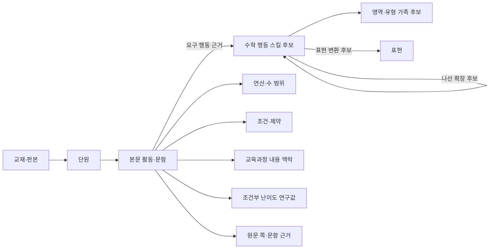

# G-FIELD 수학 사고 스킬 온톨로지

상태: 연구용 분류 체계 초안 · 교사 승인 전  
갱신: 2026-10-19 · 공개 연구 화면: [`index.html`](index.html)

## 목적

이 온톨로지는 교재의 단원명이나 소재를 모으는 목차가 아니라, 학생이 실제로 수행하는 수학 행동을 출처와 함께 연결하는 연구 그래프다. 같은 종이접기·쌓기나무·미로도 필요한 연산, 수 범위, 표현, 조건 조합이 다르면 별도 활동과 스킬 후보로 기록한다. 반대로 같은 행동이 다른 교재와 학년에서 반복되면 원문 활동을 중복 저장하지 않고 근거 링크로 연결한다.

그래프는 교재 배열과 나선형 복습 후보, 문제은행의 유형·표현·연산·조건 검색을 돕는다. 연구 후보만으로 확정된 학습 순서, 학년 추천, 난이도 판정이나 정답을 주장하지 않는다.

## 핵심 그래프

## 노드

| 노드 종류 | 기록 내용 |
|---|---|
| 교재·판본 | 교재명, 단계, 판본·파일 식별 정보 |
| 단원 | 교재 내 단원 및 인쇄 쪽 범위 |
| 활동·문항 | 본문 블록, 하위 문항, 안내 예시 여부, 관찰된 풀이 행동 |
| 스킬 후보 | 안정 ID, 짧은 행동명, 관찰 가능한 행동, 영역 순번 후보 |
| 스킬 가족 | 상위 영역·유형 가지와 소속 후보 |
| 수학 요소 | 표현, 연산, 수 범위, 조건·제약, 사용 재료 |
| 교육과정 맥락 | 성취기준 및 학년군 내용 참조. 최소 교과수준 판정과 분리 |
| 연구 판단 | 난이도 후보, 최소 교과수준 후보, 가설 관계와 상태 |
| 출처 근거 | 파일·판본, 실제/인쇄 쪽, 문항 ID, 추출·시각 확인 상태 |

## 관계와 해석

| 관계 | 의미 | 자동으로 뜻하지 않는 것 |
|---|---|---|
| `requires-skill` / 선수 후보 | 활동에서 선행 행동이 필요할 수 있다는 근거 기반 가설 | 확정된 수업 순서·학년 |
| `uses-together` | 한 활동에서 함께 관찰된 행동 | 둘 사이의 선후 |
| `representation-change` | 같은 관계를 그림·표·식·격자·입체 관점 사이에서 변환 | 유형 동등성 |
| `spiral-extension-candidate` | 행동이 더 큰 수, 연산, 제약, 표현 또는 줄어든 발판에서 재등장할 수 있다는 가설 | 승인된 나선 순서 |
| `family-member-candidate` | 스킬을 상위 영역·가족에 임시 배치 | 최종 편집 분류 |
| `related-but-distinct` | 비슷한 소재·개념에도 요구 행동이 달라 별도 후보로 둠 | 서로 무관하다는 뜻 |
| `curriculum-context` | 성취기준·학년군의 관련 내용 맥락 | 문항의 최저 이수 학년 |
| `source-evidence` | 판단을 뒷받침하는 원문 활동·쪽 연결 | 정답 또는 그림 복원 검증 |

관계에는 가능한 경우 시작·도착 활동 ID, 근거, 판본, 확신 상태, 검토 상태를 붙인다. 추정 관계는 후보로 유지하며 승인 관계와 섞지 않는다. `related-but-distinct`는 표면 유사성만으로 유형을 합치지 않게 하는 분리 근거로 사용한다.

## 유형·난이도·교과수준

- **유형 후보**는 학생의 관찰 가능한 행동으로 정의한다. 단원 제목, 교재 단계, 소재만으로 유형을 부여하지 않는다.
- **조건부 난이도**는 통일된 연구 기준에 따라 수 범위, 연산, 조건 수, 단계 수, 표현, 발판, 탐색 공간 등을 관찰한 임시 밴드다. 교사 승인 전에는 학생 배치나 교재의 확정 순서로 사용하지 않는다.
- **최소 교과수준**은 문항을 해결하는 데 실제로 필요한 최소 연산·수 범위·표현과 공식 교육과정 및 관련 부교재의 근거를 함께 확인해 정한다. 근거가 부족하면 `null`과 보류 사유를 보존한다.
- **학년·나이**는 최소 교과수준 및 스킬 난이도와 별도 축이다. 특정 교재의 진도표나 성취기준 학년군이 개별 문항의 최소 학년을 자동 결정하지 않는다.
- **정답·도형·필기 검증**은 서로 독립 상태로 관리한다. OCR 또는 자동 분류 결과만으로 승인하지 않는다.

## 계통도와 교재 편성

영역 안에서 먼저 행동 후보와 직접 근거를 정리한 뒤, 선수 후보를 검토한다. 내림차순 편성은 확인된 행동과 난이도 근거가 있을 때만 제안한다. 나선형 구성은 이미 다룬 행동이 다른 수 범위·연산·표현·제약에서 다시 사용되는 근거 쌍을 보여준다. 계통 분류와 실제 교수 순서는 동일하지 않으며, 교사 검토가 끝나기 전에는 후보 경로로 표시한다.

같은 활동을 다시 출제하거나 표현만 바꾼 경우에는 원 활동 ID와 파생 문항을 연결한다. 문제은행은 스킬, 표현, 연산, 수 범위, 조건, 난이도 근거를 별도 필터로 제공할 수 있도록 각 요소를 분리 저장한다.

## 데이터 상태와 공개 범위

상태는 원문 확인, 연구 후보, 검토된 관계, 교사 승인 등을 구별한다. 공개 단원 보충 JSON에는 문제 유형과 연구 통계를 검토할 수 있는 내용만 두고, 로컬 절대 경로와 원본 이미지 해시 같은 내부 경로 정보를 포함하지 않는다. 원문 이미지와 상세 검토 기록은 접근 권한이 있는 연구 저장소에서 관리한다.

2026-10-19 체크포인트(v99)에서 통합 그래프는 노드 1,640개, 관계 3,099개, 스킬 후보 414개를 포함한다. 후보 근거가 연결된 활동은 846개, 추가 검토 대기 활동은 6개다. 활동-스킬 근거 관계는 903개, 조건부 난이도 후보는 852개다. 답안 검증은 313개이며 최소 교과수준 배정과 교사 승인 관계는 아직 0개다. 이는 검토 진행량이지 최종 유형 수나 교재 완성도를 뜻하지 않는다.

## 단원별 데이터

Pre D 3단원에서는 자료별 빈도 세기, 표·그래프 변환, 두 분류 빈도의 차 비교, 원그래프 선택, 표의 행·열 조건 해석, 질문에 맞는 집계 단위 선택, 자료 변경 뒤 최솟값 재비교를 8개 행동 후보로 나눴다. 소마 A4-3 1행은 초2-1 분류하기 진도와 연결되는 진행 맥락이며 정확 유형 일치는 0건이다. 교육과정 표·그래프 기준도 내용 맥락으로만 연결했다. 최소 교과수준은 8개 활동 모두 미확정이다.

Pre D 4단원은 37–43쪽의 10개 활동을 재방문 금지 조건 아래 모든 경로 열거, 연결망의 최단 경로 수 찾기, 길망 간 경로 수 비교의 3개 행동 후보로 구분했다. 모든 경로와 최단 경로를 같은 유형으로 합치지 않았다. 기존 영역 순번표의 05-001/002/003/009/010은 의미 비교 후보로만 연결했으며, 영역 순번은 난이도·학습 순서·확정 공통 유형 번호가 아니다. p.43 막힌 간선의 정확한 위치, 정답, 최소 교과수준은 미확정이다. 소마 A4-3 3행은 진도 맥락으로만 참고했다.

단원 데이터는 `ontology-*.json` 파일에 보충 자료로 저장한다. 각 보충 자료는 스키마 버전, 체크포인트, 원문 범위, 스킬 후보, 활동 근거, 난이도·교과수준 상태, 관련 유형·나선 후보를 포함한다. 공개 연구 화면의 집계는 이 보충 자료와 통합 그래프를 기준으로 갱신한다.

Pre D 5단원은 45–51쪽 12개 활동을 위치별 색 배정, 한 집합의 무순서 쌍, 두 구별 집단의 짝, 회전·반사 동치류 세기로 구분했다. 기존 행동 후보 4개를 재사용하고 새 후보는 만들지 않았다. 영역 편성 번호 05-016/017/018/019/026/040은 의미 비교 후보일 뿐 확정 공통 유형 번호가 아니다. 조건부 난이도 12개는 교사 검토 전이며 최소 교과수준 12개와 정답은 모두 미확정·미검증이다. 소마 진도표는 진행 맥락으로만 연결했다.

## Pre D6 「문제 만들기」 연구 (v77)

Pre D6 본문 55–61쪽의 8개 활동을 원문 및 보존된 Mac Vision 시각 검토 기록과 대조했다. 질문에 답할 정보가 충분한지 판별하는 두 활동은 기존 FOLD07 행동 후보를 재사용하되, 접기 문항에서 얻은 근거와 산술 문장제 문항에서 얻은 근거는 별도 맥락으로 보존한다. 새 후보는 그림·수량에서 산술 문제 만들기, 분류 기준에 맞는 식 만들기, 조건 문장과 질문을 연결해 문제 완성하기의 3개다.

계통 가족은 연구 묶음 후보이며 유형 동등성이나 선수 순서를 뜻하지 않는다. 01-131 등 기존 영역 순번과의 연결은 의미 비교 후보로만 두고 공통 유형 번호로 승인하지 않았다. 초등 1–2학년군 교육과정의 실생활 덧셈·뺄셈 문제 만들기 언급은 맥락 근거로만 기록했으며, 8개 활동의 최소 교과수준은 미배정이다. 난이도 밴드 8개는 조건부 연구값이고 답안은 검증하지 않았다.

공개 단원 부록은 `ontology-pre-d-u6.json`이다. 이 보충 자료는 기존 공개 데이터 구조를 보존하며, 공식 승인 전 후보임을 모든 관계에서 표시한다.

## Pre D7 「그림 그려 해결하기」 연구 (v78)

Pre D7 본문 63–69쪽의 13개 활동을 보존된 Mac Vision 시각 검토·OCR 및 페이지 매니페스트와 대조했다. 기존 역순 연산 행동 AR04를 재사용하고, 격자 크기 복원, 순서·집단 조건에서 전체 인원 추론, 절반과 고정량의 그림 모델, 공유 경계 꼭짓점 중복 제거의 4개 행동 후보를 추가했다.

소마 A3-1 4, A2-2 1, B1-3 4의 진도 항목은 10개 활동의 관련 진행 맥락으로만 연결했다. 별도 검토한 4개 행은 보류했으며 정확 유형 일치는 0건이다. 편집용 영역 번호 10개는 의미 비교 후보이지 승인된 공통 유형 번호가 아니다. 후보 난이도는 조건부 연구값, 답안은 미검증, 최소 교과수준 13개는 미배정이다.

신규 행동 후보는 GRID-PRED7-01, LINE-PRED7-01, PART-PRED7-01, BOUNDARY-PRED7-01이다. 공개 단원 부록은 [`ontology-pre-d-u7.json`](ontology-pre-d-u7.json)이다. OCR을 다시 실행하지 않고 보존 분석을 재사용했다.

## Pre D8 「주고 받기」 연구 (v79)

Pre D8 본문 71–77쪽의 12개 활동을 기존 Mac Vision 시각 검토·OCR 기록 및 페이지 매니페스트와 대조했다. AR01 「수량을 옮겨 같게 만들기」의 기존 활동 근거 3개를 유지하고, AR01의 새 근거 1개와 AR02 「합과 차로 두 양 복원하기」의 새 근거 6개를 반영했다. 새 행동 후보는 이동 뒤 변한 두 양의 차에서 이동량 추론, 세 집단 중 한 집단의 차이를 반영한 같은 몫 복원, 여러 출처의 초과량으로 새 목표량 채우기의 3개다.

p.77은 학생책과 같은 판본 해설 p.35를 대조해 그림 속 세 화병과 새 빈 화병을 구별했다. 해설은 조건 해석에만 참고했고 답안 검증에는 포함하지 않았다. 소마 C4-3 3, B4-3 2 등의 12개 연결은 진도·내용 맥락이며, 4개 관련 행은 보류했다. 편집용 영역 번호 7개는 의미 비교 후보로만 둔다.

난이도 12개는 교사 승인 전 조건부 연구값, 문항별 최소 교과수준 12개는 미배정, 답안은 미검증이다. 이미 AR01로 연결된 3개는 중복 집계하지 않았다. 공개 부록은 [`ontology-pre-d-u8.json`](ontology-pre-d-u8.json)이다. OCR을 다시 실행하지 않고 보존 분석을 사용했다.

## Pre D9 「거꾸로 해결하기」 연구 (v80)

Pre D9 본문 79–85쪽의 12개 활동을 기존 Mac Vision 시각 검토·OCR 기록과 페이지 매니페스트에 대조했다. AR04 「끝 상태에서 연산 순서 거꾸로 복원하기」의 기존 근거 4개를 유지하고 새 활동 5개를 더 연결했다. 반대 방향으로 움직이는 시계의 바늘 표시 추적과 마지막 돌 승리 조건에서 첫 수를 역으로 추론하기를 별도 행동 후보 2개로 추가해, 12개 활동을 빠짐없이 후보에 연결했다. 기존 OCR은 다시 실행하지 않았다.

소마 진도표는 10개 활동의 진행 맥락으로 연결했고, 직접 대응 행이 없는 2개 활동 및 관련 행 5개는 별도로 보류했다. 영역 순번 후보 4개는 의미 비교 대상으로만 두었다. 조건부 난이도 12개는 교사 승인 전 연구값이며 문항별 최소 교과수준 12개는 미배정, 답안 12개는 미검증이다. 공개 단원 부록은 [`ontology-pre-d-u9.json`](ontology-pre-d-u9.json)이다.

## Pre D10 「톱니바퀴 문제」 연구 (v81)

Pre D10 본문 87–93쪽의 10개 활동을 보존된 시각 검토·OCR 기록 및 페이지 매니페스트와 대조하고 페이지 이미지를 직접 확인했다. 톱니 수와 회전량의 곱 보존으로 맞물린 바퀴의 회전량을 찾기, 맞물림 경로에서 방향 반전 짝홀로 목표 바퀴를 찾기, 벨트와 기어 맞물림의 서로 다른 방향 규칙을 합성하기의 세 행동 후보로 구분했다. OCR은 재실행하지 않았다.

소마 D1-2 4는 곱셈·나눗셈 조건을 사용하는 4개 활동의 부분 행동 진도 맥락으로만 연결했다. 직접 행 대응이 확인되지 않은 활동 6개와 관련 행 5개는 보류했다. 영역 순번 02-055, 07-035, 07-036은 의미 비교 후보이며 공통 유형 번호가 아니다. 최소 교과수준 10개는 미배정, 답안 10개는 미검증이다. 난이도 10개는 기존 보존 연구의 조건부 값으로 교사 승인을 받지 않았다. 공개 단원 부록은 [`ontology-pre-d-u10.json`](ontology-pre-d-u10.json)이다.

## 1031 Pre B5–B6 체크포인트 (v87)

Pre B5 접기·자르기 11개 활동은 기존 해설 대조 및 독립 재계산 기록을 재사용했다. 기존 누계에 이미 포함되어 있어 답안 검증 수를 더하지 않았다.

Pre B6 입체도형 퍼즐 53–59쪽의 10개 활동은 기존 행동 유형·조건부 난이도 후보를 재사용했다. 해설 pp.24–27 대조로 답안 검증 10건을 추가했고 누계는 98건이다. 최소 교과수준은 10개 모두 미배정이며 교사 승인 관계는 없다. 공개 보충 자료는 [`ontology-pre-b-u6-v87.json`](ontology-pre-b-u6-v87.json)이다. 답안 세부와 원문 이미지는 공개 저장소에 포함하지 않는다.

## 1031 Pre B7 「길이 비교하기」 연구 (v88)

Pre B7 본문 63–69쪽의 12개 활동은 기존 행동 유형과 조건부 난이도 후보를 재사용했다. 해설 pp.28–31을 시각 대조해 답안 근거 12건을 추가했고 누계는 110건이다. 소마 목차는 길이 비교 맥락으로 연결하되, 미로 최단 경로와 닫힌 도형 둘레는 서로 다른 요구 행동이므로 관련 행을 보류했다. 최소 교과수준 12건은 미배정이며 교사 승인 관계는 없다. 공개 보충 자료는 [`ontology-pre-b-u7.json`](ontology-pre-b-u7.json)이다.

## 1031 Pre B9 「넓이 비교하기」 연구 (v90)

Pre B9 본문 79–85쪽의 9개 활동은 보존된 시각 검토, 행동 후보, 조건부 난이도 후보를 재사용했다. 기존 덮기 행동 1개와 새 넓이 분해·비교, 넓이 보존 구성, 절단 조각 재구성 후보 3개로 구분하며, 활동별 관계와 나선 연결은 후보로 유지한다. 해설 pp.36–39를 시각 대조해 답안 근거 9건을 추가했고 전체 누계는 131건이다. 구성 문항은 해설 예시 응답이며 가능한 답을 하나로 제한하지 않는다. 최소 교과수준 9건은 미배정, 교사 승인 관계·난이도는 0건이다. 소마 직접 대응 8건은 진도 맥락으로만 연결하고 직접 행이 없는 1건과 관련 행 3건은 보류했다. 공개 보충 자료는 [`ontology-pre-b-u9.json`](ontology-pre-b-u9.json)이다.

## 1031 Pre B8 「무게 비교하기」 연구 (v89)

Pre B8 본문 71–77쪽의 12개 활동은 기존 행동 유형·조건부 난이도 후보를 재사용했다. 해설 pp.32–35와 대조해 답안 12건을 추가했고 전체 답안 검증 누계는 122건이다. 소마 진도 항목 12건은 저울·무게·가격 관계의 내용 맥락으로 연결했으며, 닫힌 도형이나 다른 행동의 행은 보류했다. 최소 교과수준 12건은 미배정이고 교사 승인 관계는 없다. 공개 보충 자료는 [`ontology-pre-b-u8.json`](ontology-pre-b-u8.json)이다.

## Pre B 10단원 답안 검증 (v91)

기존 활동 매핑과 조건부 난이도 후보 10개를 재사용했다. 해설 pp.40–43에서 답안 근거 10건을 대조했다. 최소 교과수준은 계속 미배정이며 교사 승인은 0건이다. 공개 단위 보충 자료에는 정확한 정답을 싣지 않는다.

## 1031 Pre C1 「패턴」 답안 검증 (v92)

본문 13–19쪽의 기존 13개 활동 분류와 조건부 난이도 후보를 재사용했다. 같은 판본 해설 pp.4–7에서 답안 근거 13건을 확인했다. 최소 교과수준 후보는 미배정이며, 구성 문항의 답은 해설 예시로 기록해 복수 답 가능성을 유지한다. 공개 보충 자료는 [`ontology-pre-c-u1.json`](ontology-pre-c-u1.json)이다.

## 1031 Pre C2 「여러 가지 규칙」 답안 검증 (v93)

본문 21–27쪽의 기존 13개 활동 분류·조건부 난이도 후보를 재사용했다. 같은 판본 해설 pp.8–11과 대조해 답안 근거 13건을 확인했다. 유형 후보는 행렬 속성 분리, 겹침 합성, 둘레 순환 이동, 격자 위치 변환, 규칙 분리 적용, 회전 원판 상태 추적으로 유지한다. 최소 교과수준은 미배정이다. 공개 보충 자료는 [`ontology-pre-c-u2.json`](ontology-pre-c-u2.json)이다.

## 1031 Pre C3 「규칙 상자」 답안 검증 (v94)

본문 29–35쪽의 기존 활동 유형 연결과 조건부 난이도 후보를 재사용했다. 같은 판본 해설 pp.12–15에서 답안 근거 10건을 확인했다. 새 난이도 후보와 최소 교과수준 배정은 추가하지 않았다. 문항별 정답은 공개 보충 파일에 포함하지 않는다. [`ontology-pre-c-u3.json`](ontology-pre-c-u3.json)

## 1031 Pre C4 「달력 속 규칙」 답안 검증 (v95)

본문 37–43쪽의 기존 13개 활동 유형·난이도 후보를 재사용했다. 같은 판본 해설 pp.16–19에서 답안 근거 13건을 확인했다. 새 난이도 후보와 최소 교과수준 배정은 추가하지 않았다. 문항별 정답은 공개 보충 자료에 포함하지 않는다. [`ontology-pre-c-u4.json`](ontology-pre-c-u4.json)

## 1031 Pre C5 「늘어나는 규칙」 답안 검증 (v96)

기존 11개 활동 분류와 조건부 난이도 후보를 재사용하고 같은 판본 해설 pp.20–23에서 답안 근거 11건을 확인했다. 신규 유형·난이도 후보는 추가하지 않았으며 최소 교과수준은 미배정이다. 공개 보충 자료는 [`ontology-pre-c-u5.json`](ontology-pre-c-u5.json)이다.

## 1031 Pre C6 「유추하기」 답안 검증 (v97)

본문 55–61쪽의 기존 13개 활동·8개 행동 후보·조건부 난이도 후보를 재사용하고 같은 판본 해설 pp.24–27에서 답안 근거를 확인했다. 신규 유형·난이도 후보와 최소 교과수준 배정은 추가하지 않았다. 도전문제 3-(4)의 관계 유형은 미분류 상태다. 공개 부록은 [`ontology-pre-c-u6.json`](ontology-pre-c-u6.json)이다.

## 1031 Pre C7 「순서와 자리」 답안 검증 (v99)

본문 63–69쪽의 기존 13개 활동·6개 행동 후보·조건부 난이도 후보를 재사용하고 같은 판본 해설 pp.28–31에서 답안 근거 13건을 확인했다. 신규 유형·난이도 후보 및 최소 교과수준 배정은 추가하지 않았다. 공개 부록은 [`ontology-pre-c-u7.json`](ontology-pre-c-u7.json)이다.

### 1031 Pre C 8단원 ○× 추리 (v99)

기존 11개 활동 유형 연결과 조건부 난이도 후보를 재사용했습니다. 같은 판본 해설 pp.32–35와 대조해 11개 답안을 검증했습니다. 새로운 행동 유형·난이도 후보는 추가하지 않았으며, 활동별 최소 교과수준 11개는 계속 미확정입니다. 공개 자료에는 정답 값을 싣지 않습니다.

### 1031 Pre C 8단원 ○× 추리 (v99)

기존 11개 활동 유형 연결과 조건부 난이도 후보를 재사용했습니다. 같은 판본 해설 pp.32–35와 대조해 11개 답안을 검증했습니다. 새로운 행동 유형·난이도 후보는 추가하지 않았으며, 활동별 최소 교과수준 11개는 계속 미확정입니다. 공개 자료에는 정답 값을 싣지 않습니다.

### 1031 Pre C 8단원 ○× 추리 (v99)

기존 11개 활동 유형 연결과 조건부 난이도 후보를 재사용했습니다. 같은 판본 해설 pp.32–35와 대조해 11개 답안을 검증했습니다. 새로운 행동 유형·난이도 후보는 추가하지 않았으며, 활동별 최소 교과수준 11개는 계속 미확정입니다. 공개 자료에는 정답 값을 싣지 않습니다.

### 1031 Pre C 8단원 ○× 추리 (v99)

기존 11개 활동 유형 연결과 조건부 난이도 후보를 재사용했습니다. 같은 판본 해설 pp.32–35와 대조해 11개 답안을 검증했습니다. 새로운 행동 유형·난이도 후보는 추가하지 않았으며, 활동별 최소 교과수준 11개는 계속 미확정입니다. 공개 자료에는 정답 값을 싣지 않습니다.

### 1031 Pre C 9단원 논리 판단 (v101)

해시 일치 보존 기록에서 본문 79–85쪽의 시각 검토 완료를 확인하고, 기존 10개 활동 연결과 조건부 난이도 후보를 재사용했습니다. 같은 판본 해설 pp.36–39에서 10개 답을 검증했습니다. 새 행동 유형·난이도 후보는 추가하지 않았으며, 활동별 최소 교과수준 10개는 미확정입니다. 공개 자료에는 정답 값을 싣지 않습니다.

## 1031 Pre C 10 · 논리 퍼즐 (v101)

Same-edition answer key pages 40–43 checked against ten activities. Existing body review, mappings, and conditional difficulty bands were reused. No new candidates were added. Minimum curriculum level remains unresolved for all ten activities. Cumulative validated answers: 258.

## 1031 Pre D 1–2 · v102

해시가 일치하는 보존 시각 검토에서 본문 각 7쪽과 기존 활동·난이도 분류 21건을 재사용했다. 같은 판본 해설 4–11쪽의 시각 대조로 학생 응답 19건을 검증했으며 단원별 설명 예시 1개씩은 제외했다. 새로운 유형·난이도 후보는 추가하지 않았고 최소 교과수준은 21개 모두 미확정이다. 누적 답안 검증은 277개다.

## 1031 Pre D 3 · 표와 그래프 (v103)

해시가 일치하는 보존 시각 검토 7쪽과 기존 활동·난이도 후보 8건을 재사용했다. 같은 판본 해설 12–15쪽을 대조해 8개 활동 블록을 검증했다. 신규 유형·난이도 후보는 없고 최소 교과수준은 8개 모두 미확정이다. 누적 답안 검증은 285개다.

## 1031 Pre D 4 · 길 찾기 (v104)

보존된 시각 검토 7쪽과 기존 10개 활동·행동 후보·조건부 난이도 후보를 재사용했다. 같은 판본 해설 16–19쪽을 대조해 학생 응답 9건을 확인했고 수업 예시 1건은 누계에서 제외했다. 새 유형·난이도 후보는 추가하지 않았다. 최소 교과수준 10건은 미확정이며 p.43 길 표시 세부의 기존 보류는 유지했다. 누적 답안 검증은 294개다.

## 1031 Pre D 5 · 여러 가지 방법의 수 (v105)

보존된 시각 검토 7쪽과 기존 12개 활동·행동 후보·조건부 난이도 후보를 재사용했다. 같은 판본 해설 20–23쪽을 대조해 학생 응답 11건을 확인했고 수업 예시 1건은 누계에서 제외했다. 신규 유형·난이도 후보는 추가하지 않았고 최소 교과수준 12건은 미확정이다. 누적 답안 검증은 305개다. 공개 보충 자료는 [`ontology-pre-d-u5.json`](ontology-pre-d-u5.json)이다.

## 1031 Pre D 6 · 문제 만들기 (v106)

보존 시각 검토 7쪽과 기존 8개 활동·행동 후보·조건부 난이도 후보를 재사용했다. 같은 판 해설 24–27쪽에서 답 근거 8건을 시각 대조했다. 문제 만들기 활동의 해설은 예시 답으로만 취급해 대체 가능한 타당한 문항을 배제하지 않는다. 새 후보는 추가하지 않았고 최소 교과수준 8건은 미확정이다. 누적 답안 검증은 313개다. 공개 보충 자료는 [`ontology-pre-d-u6.json`](ontology-pre-d-u6.json)이다.
