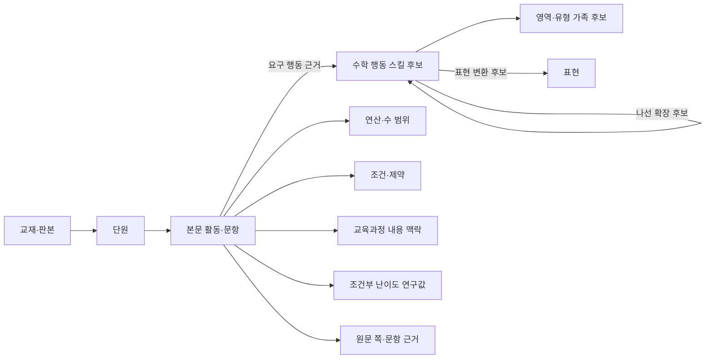

# G-FIELD 수학 사고 스킬 온톨로지

상태: 연구용 분류 체계 초안 · 교사 승인 전  
갱신: 2026-10-19 · 공개 연구 화면: [`index.html`](index.html)

## 목적

이 온톨로지는 교재의 단원명이나 소재를 모으는 목차가 아니라, 학생이 실제로 수행하는 수학 행동을 출처와 함께 연결하는 연구 그래프다. 같은 종이접기·쌓기나무·미로도 필요한 연산, 수 범위, 표현, 조건 조합이 다르면 별도 활동과 스킬 후보로 기록한다. 반대로 같은 행동이 다른 교재와 학년에서 반복되면 원문 활동을 중복 저장하지 않고 근거 링크로 연결한다.

그래프는 교재 배열과 나선형 복습 후보, 문제은행의 유형·표현·연산·조건 검색을 돕는다. 연구 후보만으로 확정된 학습 순서, 학년 추천, 난이도 판정이나 정답을 주장하지 않는다.

## 핵심 그래프

## 노드

| 노드 종류 | 기록 내용 |
|---|---|
| 교재·판본 | 교재명, 단계, 판본·파일 식별 정보 |
| 단원 | 교재 내 단원 및 인쇄 쪽 범위 |
| 활동·문항 | 본문 블록, 하위 문항, 안내 예시 여부, 관찰된 풀이 행동 |
| 스킬 후보 | 안정 ID, 짧은 행동명, 관찰 가능한 행동, 영역 순번 후보 |
| 스킬 가족 | 상위 영역·유형 가지와 소속 후보 |
| 수학 요소 | 표현, 연산, 수 범위, 조건·제약, 사용 재료 |
| 교육과정 맥락 | 성취기준 및 학년군 내용 참조. 최소 교과수준 판정과 분리 |
| 연구 판단 | 난이도 후보, 최소 교과수준 후보, 가설 관계와 상태 |
| 출처 근거 | 파일·판본, 실제/인쇄 쪽, 문항 ID, 추출·시각 확인 상태 |

## 관계와 해석

| 관계 | 의미 | 자동으로 뜻하지 않는 것 |
|---|---|---|
| `requires-skill` / 선수 후보 | 활동에서 선행 행동이 필요할 수 있다는 근거 기반 가설 | 확정된 수업 순서·학년 |
| `uses-together` | 한 활동에서 함께 관찰된 행동 | 둘 사이의 선후 |
| `representation-change` | 같은 관계를 그림·표·식·격자·입체 관점 사이에서 변환 | 유형 동등성 |
| `spiral-extension-candidate` | 행동이 더 큰 수, 연산, 제약, 표현 또는 줄어든 발판에서 재등장할 수 있다는 가설 | 승인된 나선 순서 |
| `family-member-candidate` | 스킬을 상위 영역·가족에 임시 배치 | 최종 편집 분류 |
| `related-but-distinct` | 비슷한 소재·개념에도 요구 행동이 달라 별도 후보로 둠 | 서로 무관하다는 뜻 |
| `curriculum-context` | 성취기준·학년군의 관련 내용 맥락 | 문항의 최저 이수 학년 |
| `source-evidence` | 판단을 뒷받침하는 원문 활동·쪽 연결 | 정답 또는 그림 복원 검증 |

관계에는 가능한 경우 시작·도착 활동 ID, 근거, 판본, 확신 상태, 검토 상태를 붙인다. 추정 관계는 후보로 유지하며 승인 관계와 섞지 않는다. `related-but-distinct`는 표면 유사성만으로 유형을 합치지 않게 하는 분리 근거로 사용한다.

## 유형·난이도·교과수준

- **유형 후보**는 학생의 관찰 가능한 행동으로 정의한다. 단원 제목, 교재 단계, 소재만으로 유형을 부여하지 않는다.
- **조건부 난이도**는 통일된 연구 기준에 따라 수 범위, 연산, 조건 수, 단계 수, 표현, 발판, 탐색 공간 등을 관찰한 임시 밴드다. 교사 승인 전에는 학생 배치나 교재의 확정 순서로 사용하지 않는다.
- **최소 교과수준**은 문항을 해결하는 데 실제로 필요한 최소 연산·수 범위·표현과 공식 교육과정 및 관련 부교재의 근거를 함께 확인해 정한다. 근거가 부족하면 `null`과 보류 사유를 보존한다.
- **학년·나이**는 최소 교과수준 및 스킬 난이도와 별도 축이다. 특정 교재의 진도표나 성취기준 학년군이 개별 문항의 최소 학년을 자동 결정하지 않는다.
- **정답·도형·필기 검증**은 서로 독립 상태로 관리한다. OCR 또는 자동 분류 결과만으로 승인하지 않는다.

## 계통도와 교재 편성

영역 안에서 먼저 행동 후보와 직접 근거를 정리한 뒤, 선수 후보를 검토한다. 내림차순 편성은 확인된 행동과 난이도 근거가 있을 때만 제안한다. 나선형 구성은 이미 다룬 행동이 다른 수 범위·연산·표현·제약에서 다시 사용되는 근거 쌍을 보여준다. 계통 분류와 실제 교수 순서는 동일하지 않으며, 교사 검토가 끝나기 전에는 후보 경로로 표시한다.

같은 활동을 다시 출제하거나 표현만 바꾼 경우에는 원 활동 ID와 파생 문항을 연결한다. 문제은행은 스킬, 표현, 연산, 수 범위, 조건, 난이도 근거를 별도 필터로 제공할 수 있도록 각 요소를 분리 저장한다.

## 데이터 상태와 공개 범위

상태는 원문 확인, 연구 후보, 검토된 관계, 교사 승인 등을 구별한다. 공개 단원 보충 JSON에는 문제 유형과 연구 통계를 검토할 수 있는 내용만 두고, 로컬 절대 경로와 원본 이미지 해시 같은 내부 경로 정보를 포함하지 않는다. 원문 이미지와 상세 검토 기록은 접근 권한이 있는 연구 저장소에서 관리한다.

2026-10-19 체크포인트(v74)에서 통합 그래프는 노드 1,560개, 관계 2,866개, 스킬 후보 390개를 포함한다. 후보 근거가 연결된 활동은 777개, 추가 검토 대기 활동은 75개다. 활동-스킬 근거 관계는 828개, 조건부 난이도 후보는 748개다. 답안 검증은 42개이며 최소 교과수준 배정과 교사 승인 관계는 아직 0개다. 이는 검토 진행량이지 최종 유형 수나 교재 완성도를 뜻하지 않는다.

## 단원별 데이터

Pre D 3단원에서는 자료별 빈도 세기, 표·그래프 변환, 두 분류 빈도의 차 비교, 원그래프 선택, 표의 행·열 조건 해석, 질문에 맞는 집계 단위 선택, 자료 변경 뒤 최솟값 재비교를 8개 행동 후보로 나눴다. 소마 A4-3 1행은 초2-1 분류하기 진도와 연결되는 진행 맥락이며 정확 유형 일치는 0건이다. 교육과정 표·그래프 기준도 내용 맥락으로만 연결했다. 최소 교과수준은 8개 활동 모두 미확정이다.

단원 데이터는 `ontology-*.json` 파일에 보충 자료로 저장한다. 각 보충 자료는 스키마 버전, 체크포인트, 원문 범위, 스킬 후보, 활동 근거, 난이도·교과수준 상태, 관련 유형·나선 후보를 포함한다. 공개 연구 화면의 집계는 이 보충 자료와 통합 그래프를 기준으로 갱신한다.
